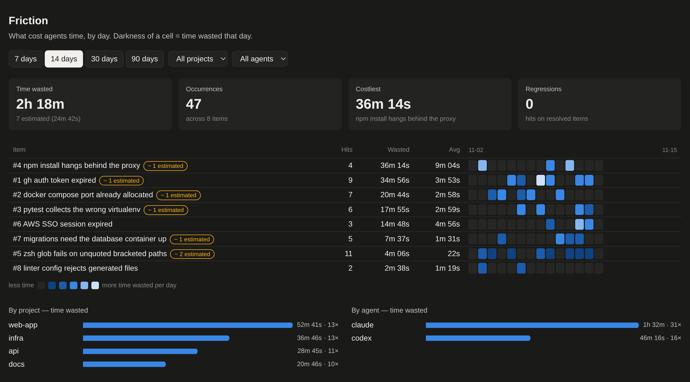

<div align="center">

# 🪨 friction

**Find out what is wasting your coding agents' time, and make them tell each other how to get past it.**

[](https://github.com/martinwheeler/friction/actions/workflows/test.yml)
[](LICENSE)


[Install](#install) · [How it works](#how-it-works) · [Docs](https://martinwheeler.github.io/friction-docs/) · [Commands](#commands) · [Jira sync](#sync-with-jira) · [Privacy](#privacy) · [Uninstall](#uninstall)



</div>

---

Agents lose a surprising amount of time to things that have nothing to do with the task: an expired
token, a command that needs quoting in your shell, a port a stale container still holds. Each new
session rediscovers the same problem and pays for it again.

friction is a small local log of those problems. Hooks time every tool call, agents name the
friction they hit and upvote the ones already known, and every new session starts with the current
worst offenders and their workarounds. You get a heatmap of where the time goes.

- **Measured, not guessed.** Wasted time comes from hook timestamps on real tool calls.
- **Shared across agents.** Claude Code and Codex write to one database on your machine.
- **Self-healing.** A workaround logged once is handed to every later session.
- **Nothing to run.** Python standard library and one SQLite file. No server, no account, no network.
- **Or share it with the team.** Optionally keep the items in [Jira](#sync-with-jira), so everyone's
  agents see the same list.

## Install

```sh
curl -fsSL https://raw.githubusercontent.com/martinwheeler/friction/main/install.sh | bash
```

Needs `python3` and `git`. Linux and macOS. CI covers Python 3.11 and newer; 3.8 to 3.10 should
work but are not tested.

The installer is safe to re-run, and re-running it updates. It:

1. clones the repo to `~/.local/share/friction/app`
2. links the `friction` command into `~/.local/bin`
3. links the agent skill into `~/.agents/skills`, `~/.claude/skills` and `~/.codex/skills`
4. adds the hook to `~/.claude/settings.json` and `~/.codex/hooks.json` (merged with what is there, with a `.bak` copy saved first)
5. starts the web view on <http://127.0.0.1:8798> and a nightly backfill, as background services
   that come back at login: systemd user units on Linux, launchd LaunchAgents on macOS

Steps for an agent you do not have installed are skipped.

<details>
<summary>Options, and installing from a checkout</summary>

Pass options after `bash -s --`:

```sh
curl -fsSL https://raw.githubusercontent.com/martinwheeler/friction/main/install.sh | bash -s -- --dry-run
```

| Option | Effect |
|---|---|
| `--dry-run` | print every change without making it |
| `--no-hooks` | leave agent settings alone |
| `--no-claude`, `--no-codex` | skip one agent |
| `--no-services` | no background services (systemd units or LaunchAgents) |
| `--port N` | web view port (default 8798) |
| `--bin-dir DIR` | where to link `friction` (default `~/.local/bin`) |

To hack on it, clone anywhere and install that checkout:

```sh
git clone https://github.com/martinwheeler/friction.git
cd friction && ./install.sh
```

</details>

Then start a new agent session. It will be told the tool exists, and you can check on it with:

```sh
friction hot          # what is hurting right now
friction report       # terminal heatmap
friction web          # web view, if the service is not running
```

## How it works

```
 tool call ──▶ hook records start, end, success, error ──▶ friction.db
                                                               │
 agent hits a wall ──▶ friction log "gh auth token expired"    │
                         │ already known? ──▶ friction bump 3  │
                         ▼                                     ▼
                  item + occurrence, timed from the recorded tool calls
                                                               │
 next session starts ◀── top 5 hot items and their workarounds ┘
```

1. **Hooks record raw events.** `PreToolUse` opens an event, `PostToolUse` closes it with success,
   duration and error text. A call that succeeds but plainly did not do what the agent wanted
   (a `command not found` or `No such file` line with exit 0, a 401/403 or timeout from a
   network command, or a near-identical retry with no edit in between) is recorded as a *soft*
   failure, `SOFT` in timelines, and counts as friction just like a hard failure.
2. **Agents name the friction.** `friction log` searches existing items first and refuses to create
   a near-duplicate until the agent picks `bump <id>` or `--new`.
3. **Sessions get nudged.** Each session starts with the hot list. If a session ends with two or
   more failed calls and nothing logged, the agent is asked once whether that was friction.
4. **Backfill catches the rest.** `friction backfill` reads past transcripts, skips the quiet ones,
   and has a headless `claude -p` on a small model classify the rest. This is the only part that
   uses the `claude` CLI, and it is optional. Items it creates are *unverified*: their workaround
   came from a model reading tool output, so it is not shown to agents until someone runs
   `friction verify <id>` or sets the workaround with `friction workaround`. An optional
   [Jev classifier](#jev-classifier-optional) can do the sorting instead.

For the details (how time is measured, the hot list ranking, backfill, sync, the schema) and
diagrams of each part, see [How friction works](https://martinwheeler.github.io/friction-docs/).

A terminal report looks like this:

```
Friction, last 7 days: 31 occurrences of 7 items, 1h34m wasted

    id hits   wasted     avg  heat (11-09 → 11-15)    item
     1    7   27m57s   4m00s  █▒··▒▓·                 gh auth token expired
     4    2   16m29s   8m14s  ·▒·▒···                 npm install hangs behind the proxy
     6    3   14m48s   4m56s  ·▒··▒▒·                 AWS SSO session expired
     2    4   13m37s   3m24s  ··▓····                 docker compose port already allocated
     5    7    2m28s     21s  █▒·▒▒▒·                 zsh glob fails on unquoted bracketed paths

  by project: web-app 10× 33m53s, api 7× 22m40s, infra 7× 19m49s, docs 7× 18m18s
  by agent: claude 22× 1h03m, codex 9× 31m06s
```

## Commands

Agents run these themselves, guided by the bundled skill. They work just as well by hand.

| Command | Use |
|---|---|
| `friction log "<problem>" --detail "..." --workaround "..."` | record a friction item (searches first) |
| `friction bump <id> --note "..."` | you hit a known item too |
| `friction search <words>` | is this known? is there a workaround? |
| `friction hot` | open items hit recently, with workarounds |
| `friction workaround <id> "..."` | record how to get past an item |
| `friction verify <id>` | trust a backfill item's workaround so agents are shown it |
| `friction resolve <id> --fix "..."` | the cause is fixed; a later hit reopens it as a regression |
| `friction merge <src> <dst>` | fold a duplicate into the canonical item |
| `friction show <id> --events` | occurrences and the recorded tool calls behind them |
| `friction timeline` | this session's recent tool calls, with event ids |
| `friction report [--week\|--month] [--project P] [--agent A] [--json]` | heatmap |
| `friction backfill --since 30d [--dry-run] [--classifier claude\|jev] [--jev-check]` | mine past transcripts |
| `friction web [--port N]` | serve the web view |
| `friction retime [--dry-run]` | re-measure logged occurrences without time spent waiting on you |
| `friction sync [--enable\|--disable\|--check\|--dry-run]` | sync items with Jira (off by default) |

### Where the time comes from

Every occurrence records how its wasted time was obtained, and reports keep the kinds apart.

| `timing` | Meaning |
|---|---|
| `hook` | measured from live hook events, from the first bad call of the cluster (or `--from <event>`) to the end of the call that finally worked (or `--to <event>`) |
| `transcript` | measured from transcript timestamps during backfill |
| `estimate` | the agent's own `--wasted` guess, used only when no events exist. Marked `~est` in the CLI and "estimated" in the web view |
| `none` | no events and no estimate |

A *bad call* is a hard failure or a soft one. Bad calls group into clusters: a cluster ends when
the next bad call is over 10 minutes later or more than 3 clean calls intervene. The window
stops at the *resolution call*, the first clean call after the cluster's last bad call, so the
productive work done after getting past the problem (and before logging it) is not counted.
Logging one item marks only its own window, so a second problem in the same session can be
logged and timed separately. The docs walk through
[a worked example](https://martinwheeler.github.io/friction-docs/#a-worked-example): a session
whose numbers come out at 46 s under these rules, where the old rule charged 280 s.

Measured time leaves out idle gaps (over 5 minutes beyond a call's own run) and any time spent
waiting on you: from the end of a turn to your next prompt, permission prompts, and questions such
as `AskUserQuestion`. Pending user input is not friction. `friction retime` re-measures
occurrences logged before this, reading the waits from their session transcripts
(`--dry-run` to preview).

### Lifecycle

`open` → `resolved` or `wontfix`. Resolved items leave the hot list. A new hit on a resolved item
reopens it and counts as a regression.

## Sync with Jira

By default every item stays in the local database. Point friction at a Jira Cloud project and
the items live there instead, shared with your team, while the local database keeps doing the
fast work (timing, duplicate search, the heatmap).

> Jira sync is new. It has been run end to end against one Jira Cloud site with the default
> workflow, and CI tests it against a fake Jira. Custom workflows and required fields may need
> changes; please open an issue if yours does.

**Sync is off by default.** Nothing is sent anywhere until you turn it on:

```sh
friction sync --enable    # first run: writes a template to ~/.config/friction/config.ini
```

Fill in the template:

```ini
[tracker]
enabled = false
type = jira
url = https://yoursite.atlassian.net
email = you@example.com
project = FRIC
token_file = ~/.config/friction/jira-token
```

Create a personal API token at <https://id.atlassian.com/manage-profile/security/api-tokens> (it
starts with `ATATT`; an organisation admin API key will not work), put it in the token file as
the only line, and `chmod 600` it. Then:

```sh
friction sync --enable    # checks the connection, then switches sync on
friction sync --dry-run   # what the first sync would send
friction sync             # pull, then push
```

`--enable` only switches sync on if Jira answers with those settings, and says what the next sync
will push. Your first sync creates an issue for every existing item.

```sh
friction sync --check     # is it on? does the connection work? what is waiting?
friction sync --disable   # switch it off; items stay local, issues already in Jira are left
```

Changes made while sync is off are kept and sent if you enable it again.

| In friction | In Jira |
|---|---|
| a new item | an issue labelled `friction`, with detail, workaround and fix as sections |
| each occurrence (`log`, `bump`) | a comment: who hit it, where, how much time it cost |
| hit count and time wasted | a totals line at the foot of the description |
| `resolve`, `wontfix`, a regression | the issue moves to a done status, or back out of one |

It works in both directions. An issue a teammate's agent logged, a workaround someone edited in
Jira, or an issue a person closed all arrive on the next sync, and show up in every agent's hot
list and duplicate search.

- **Agents never wait on Jira.** Commands write locally and start a sync in the background. A
  new session also starts one if the last was more than ten minutes ago.
- **Offline is fine.** Unpushed changes stay flagged and go out on the next sync.
- **If both sides change the same item**, your local edit wins for the fields you edited.
- **Only items and occurrences are sent**: titles, details, workarounds, notes, project names,
  agent names and timings. Raw tool-call events never leave your machine.

<details>
<summary>More tracker options</summary>

| Key | Default | Use |
|---|---|---|
| `token_file` | | file holding the API token |
| `token_env` | `FRICTION_JIRA_TOKEN` | environment variable holding the token (checked first) |
| `token_cmd` | | command that prints the token, e.g. a password manager |
| `issue_type` | `Task` | issue type to create |
| `label` | `friction` | label that marks issues as friction items |
| `cloud_id` | | required for scoped API tokens; routes calls through `api.atlassian.com` |

`FRICTION_CONFIG` overrides the config file path. `enabled = true` or `false` in the file is the
switch that `--enable` and `--disable` flip; you can also edit it by hand.

</details>

## Privacy

Unless you enable tracker sync, everything stays on your machine, in
`~/.local/share/friction/friction.db`.

- Tool input and error text are cut to 500 characters and scrubbed of obvious secrets (tokens,
  keys, passwords in URLs) before they are stored. Treat this as a safety net, not a guarantee.
- Raw tool events are deleted after 30 days. Items and occurrences are kept.
- The web view is read-only and listens on `127.0.0.1` only.
- `friction backfill` sends transcript excerpts to the model through your own `claude` CLI. Do not
  enable the timer if you do not want that.
- The [Jev classifier](#jev-classifier-optional) is off by default. Only if you enable it are
  cluster excerpts sent to TypeSafe (`api.typesafe.ai`).
- SessionStart shows only workarounds that are verified (set by an agent or a person), so text an
  analyser model lifted from tool output is not injected into every later session.
- [Jira sync](#sync-with-jira) is off by default. If you enable it, items and occurrences are sent
  to your Jira site.
- Nothing else makes a network request.

## Configuration

| Variable | Effect |
|---|---|
| `FRICTION_DIR` | where the database lives (default `~/.local/share/friction`) |
| `FRICTION_DISABLE=1` | switch the hook off for a process tree |

### Jev classifier (optional)

Backfill uses `claude -p` unless you opt in to Jev in `~/.config/friction/classifier.json`
(the same directory as the tracker config; `FRICTION_CONFIG` moves both):

```json
{"classifier": "jev",
 "jev": {"key_file": "~/.config/friction/jev.properties", "model": "jev-1.13.0",
         "min_confidence": 0.75, "questions_per_request": 2}}
```

With Jev on, Python splits each session into clusters of bad calls. For each one, Jev answers
two choice questions: is it friction (or task iteration, probing, noise), and which existing
item it matches (or `new`). It returns probabilities, so only answers at or above
`min_confidence` are filed; the rest are counted as `uncertain`. Only clusters that are new
friction go to `claude -p`, to write the title and workaround. The key is read from
`jev.key_file` (`apiKey=...`, a bare key, or JSON with `apiKey`); without one, friction uses
`jev.properties` beside the config, then the TypeSafe key jevgrep saved with `jg auth`
(`~/.config/jevgrep/credentials.json`). A missing or invalid config
means the default `claude` flow. `--classifier claude|jev` overrides the config for one run,
and `friction backfill --jev-check` tests the key with a synthetic request that contains no
session data.

Hooks are registered for `SessionStart`, `UserPromptSubmit`, `PreToolUse`, `PermissionRequest`,
`PostToolUse`, `PostToolUseFailure` and `Stop`. The hook exits 0 on any error, so it cannot break an agent session.

## Uninstall

```sh
~/.local/share/friction/app/install.sh --uninstall
```

This removes the links, the hook entries and the services. Your database is left in place. Delete
`~/.local/share/friction` to remove that too.

## Development

| File | Role |
|---|---|
| `friction.py` | database and CLI |
| `friction_hook.py` | Claude Code and Codex hook |
| `backfill.py` | transcript mining |
| `jev.py` | optional Jev (TypeSafe) classifier client |
| `web.py`, `web.html` | read-only web view |
| `tracker.py` | optional sync with an issue tracker (Jira Cloud) |
| `SKILL.md` | instructions agents load |
| `installer.py`, `install.sh` | install, update, uninstall |

```sh
python3 -m unittest test_friction test_tracker
```

Issues and pull requests are welcome. Support for other agents needs only a hook that sends the
same five events to `friction_hook.py`.

## License

[GPL-3.0-or-later](LICENSE). Copyright © 2026 Martin Wheeler.

You may use, copy, modify and share friction. If you distribute it, or a modified version,
you must do so under the same license and make the source available.
